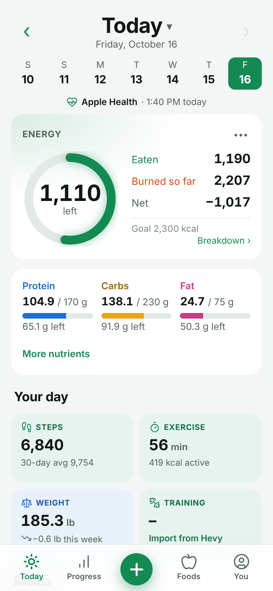
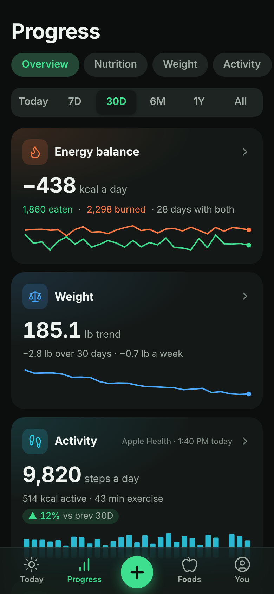
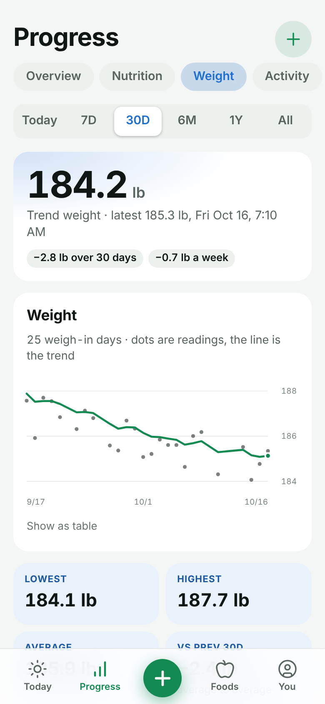

# Chomp

**A meal log you talk to.** Tell Claude (or ChatGPT) what you ate, in your own words or with a
photo of a barcode or nutrition label, and Chomp looks it up, logs it and tells you where you
stand for the day. A web dashboard on your phone shows your day, your progress and your
foods, and lets you log without a chat.

Chomp is self-hosted: it runs on your own small server, and your data stays in one file there.

<p align="center">
  
  
  
</p>

## Why it's nice

- **Just say it.** "Two scrambled eggs and a slice of sourdough at 8" is a logged breakfast.
  Corrections work the same way ("make that 220 g").
- **Real numbers, never guesses.** Every calorie and macro comes from USDA FoodData Central,
  Open Food Facts, a label you photographed, or numbers you gave. Only amounts like "a
  handful" can be estimated, and those are marked.
- **It learns your habits.** Your portions ("my handful of Cheez-Its is 30 g"), saved meals
  ("log my usual breakfast") and homemade recipes.
- **A real dashboard.** Calories left, macro goals, a calendar, nutrition facts down to
  vitamins, and charts for nutrition, weight, activity and training. It installs to your
  phone's home screen and has a dark mode.
- **Brings in the rest of your health.** Weigh-ins and daily activity from Apple Health, and
  workouts from Hevy.
- **For the household.** Each person gets their own log, goals and password, and the food
  list is shared.

See [all the features](docs/features.md).

## How it works

```
You ──chat──▶ Claude / ChatGPT ──MCP──▶ ┐
You ──phone or browser─────────────────▶ ├─ Cloudflare Tunnel ─▶ Chomp ─▶ SQLite
iPhone Shortcut (Apple Health) ────────▶ ┘                         │
                                             USDA · Open Food Facts · Hevy
```

Chomp is a small Python server. It is a custom connector (an MCP server) for Claude and
ChatGPT, and it also serves the dashboard. A Cloudflare Tunnel gives it an HTTPS address
without opening any ports at home, and its own sign-in protects it.

## Get started

You'll need:

- an always-on Linux machine with Docker (a mini PC, a VPS or a VM; 1 GB RAM is plenty),
- a domain on Cloudflare (the free plan is fine),
- a free [USDA FoodData Central API key](https://fdc.nal.usda.gov/api-key-signup),
- Claude (Free, Pro or Max) or ChatGPT, for the chat side.

The short version:

```bash
git clone https://github.com/willypete10ag/chomp.git && cd chomp
cp .env.example .env          # fill in your keys, password and tunnel token
docker compose up -d --build
```

Then add `https://chomp.<your-domain>/mcp` as a custom connector in Claude, and open
`https://chomp.<your-domain>/app` on your phone. The **[setup guide](docs/setup.md)** walks
through every step.

## Guides

- [Setup](docs/setup.md): server, Cloudflare Tunnel, connectors, dashboard, updating
- [Add another person](docs/people.md)
- [Apple Health](docs/apple-health.md): weight and activity from your iPhone
- [Hevy](docs/hevy.md): workouts
- [Backups, restore and export](docs/backups.md)
- [Development](docs/development.md): running locally, tests, architecture

## License

[MIT](LICENSE)
